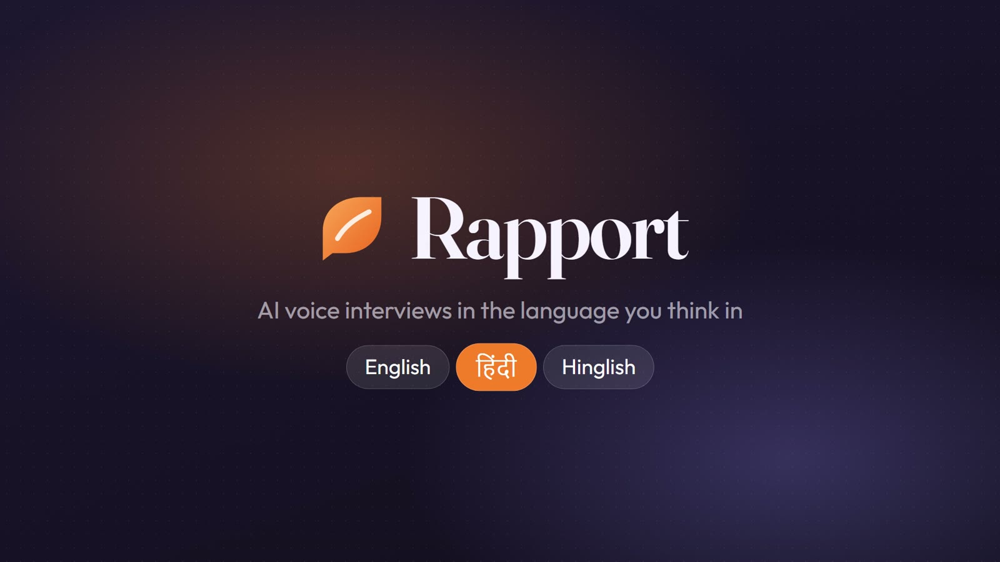
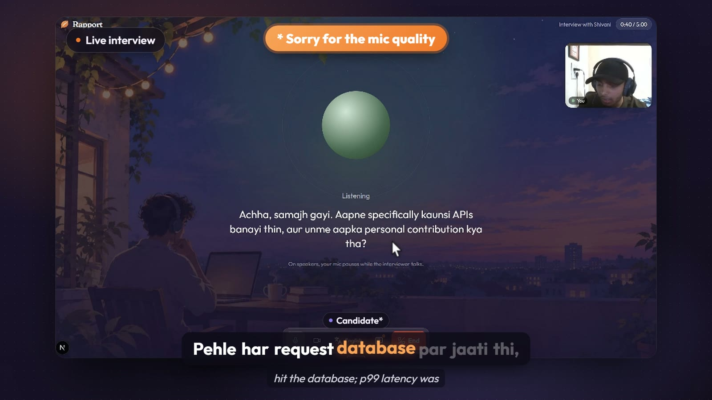
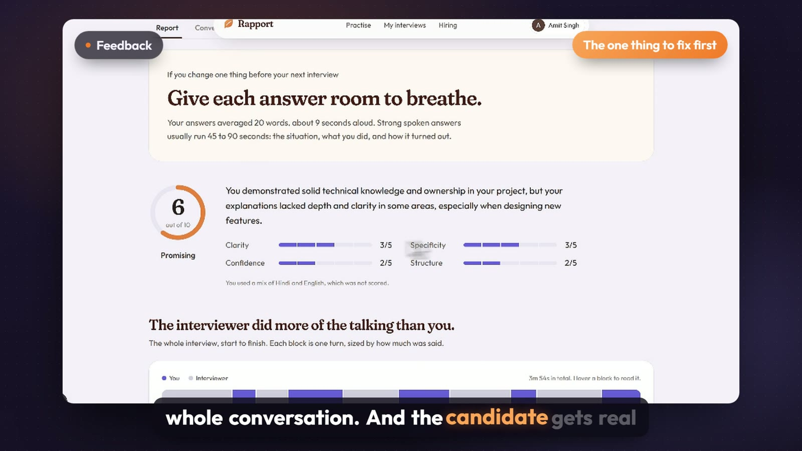

<p align="center">
  
</p>

<h1 align="center">Rapport</h1>

<p align="center"><b>Language is a bridge, not the measure of knowledge.</b></p>

<p align="center">
A real-time voice AI interviewer that speaks <b>Hindi, English and Hinglish</b>.<br>
It is one platform for AI interviews and hiring, and it judges <i>what you say</i>, not how English it sounds.
</p>

<p align="center">
  <a href="https://rapport-tawny.vercel.app"></a>
  <a href="PITCH.md"></a>
  
</p>

<p align="center"><b>Demo video (2:50):</b> <i>link coming</i></p>

---

## The problem, in 30 seconds

- **AI interviews are now the first round** for millions of job seekers. They are fast and they scale, but they don't listen like a person.
- **They grade the bridge, not the thinking.** They score English fluency and treat accent as competence. A good human interviewer follows the thought and judges whether you understand the work.
- **In India this decides careers.** English is our bridge to the world, and we need it. But only about **one in ten Indians speaks it** (Census 2011). Capable engineers, analysts and salespeople fail rounds they should pass.
- **It also feels dismissive.** A flat, robotic interviewer tells candidates they didn't even deserve a person's attention.

> **Rapport is built so every candidate is truly heard: in their own language, by a voice that feels human.**

## Rapport vs. a typical AI interview

| | Typical AI interview | **Rapport** |
|---|---|---|
| **Language** | English only | **Hindi, English or Hinglish**, and you can switch mid-interview |
| **What's judged** | Fluency and accent | **Clarity and substance.** The same answers score **8.0 / 8.0 / 8.0** in all three languages |
| **Voice** | Robotic, one-way | **Gnani Timbre**: a warm voice with natural pauses that you can interrupt |
| **Questions** | Generic | **From your resume** (what you actually built) or **set by the hiring team** |
| **When you're stuck** | Silence | It **nudges you**, using your own resume |
| **Feedback** | A number | **Coaching**: the one thing to fix, and your weakest answers rewritten from your own words, with every quote verified |
| **Hiring** | A separate tool | **One platform**: invite a large pool, review and shortlist, release results |
| **Trying it** | Book a demo | **BYOK**: paste your own keys and use the full product today |

<p align="center">
  
  <br><i>A live Hinglish interview: the interviewer follows up on a vague answer, and the candidate answers with real numbers.</i>
</p>

## One platform for hiring and AI interviews

| For candidates | For hiring teams |
|---|---|
| Take a **mock interview** for any role, any time | Build an interview once with **your own questions** |
| Or take an **interview set up by a hiring team**, right from your dashboard | **Invite a large pool** of candidates by email in one go |
| Keep several resumes and pick one per interview | Every candidate gets the **same questions**, in the language they're comfortable in |
| Get **coaching**, not just a score | Review every candidate's **scores and transcript** in one place to **shortlist** |
| Answer in Hindi, English or Hinglish | **Release results** when you're ready |

<p align="center">
  
  <br><i>The report coaches you: the one thing to fix first, how the talking was split, and stronger versions of your own answers.</i>
</p>

## Why it feels human: built on Gnani AI

- **Gnani Prisma v3.0, realtime speech-to-text.** It runs in `codemix` mode, so English terms stay in Latin script and Hindi in Devanagari, exactly as Indians speak.
- **Gnani Timbre v3.0, expressive text-to-speech.** It gives the interviewer natural pauses and breath, so it sounds like a person, not a phone menu.
- **Real-time turn-taking.** Pipecat, voice activity detection and smart-turn give a first reply in about **1.2 s** and about **1.7 s** between turns on Groq. A three-model fallback means token limits never cut an interview short, and a silent turn is retried automatically.

*Why only three languages? Gnani supports many more Indian languages, and I'm sure its team has done remarkable work on them. I chose to ship only the languages I speak and could verify myself, rather than release ones I couldn't check.*

## Try it in two minutes: bring your own key

Rapport is deliberately **BYOK (bring your own key)**, so anyone can try the full product, not just watch a demo.

1. Get a Gnani API key at [app.gnani.ai/voice](https://app.gnani.ai/voice). Students registered for Gnani's Great Indian AI Internship Challenge get **5,000 free credits**.
2. Get a free Groq key at [console.groq.com](https://console.groq.com). OpenRouter and Gemini work too.
3. Open **[rapport-tawny.vercel.app](https://rapport-tawny.vercel.app)**, paste both keys and start interviewing.

Your keys are held in memory for one interview and never stored. The backend runs on a free tier. If it's asleep, a toast tells you it's waking up, which takes about a minute.

---

## Features in detail

**Candidates**
- Practice interviews for any role and job description, as many as you like
- Resume upload, read in the browser with contact details removed. Keep several named resumes, set a default, and pick one per interview
- Optionally write the questions you want to be asked
- Technical, HR or mixed interviews of 5, 8 or 12 minutes
- Deep follow-ups (at most two in a row) and an optional pressure mode
- Scheduled interviews from recruiters appear on your dashboard, matched by your verified Google email, and use your default resume
- A turn-by-turn transcript. Guest results can be saved to an account after signing in

**Recruiters**
- Interview templates: role, job description, your own questions (asked in order, with live follow-ups), type, length, language, pressure mode, follow-ups and key terms
- Bulk invites by pasting a list of emails
- Status tracking, with transcripts and scores for every candidate
- Results stay hidden from candidates until you release them

## How it works

```
Browser (Next.js)
  ├─ pages, Auth0 session ──► Next.js server ──► /api/backend/* bridge ──► Python API (FastAPI)
  └─ mic PCM 16 kHz ◄──── websocket ────► Python API: Pipecat pipeline
                                              Gnani Prisma v3.0 STT (realtime)
                                              → user turn (Silero VAD + smart-turn)
                                              → LLM (Groq by default, or OpenRouter / Gemini; streaming)
                                              → Gnani Timbre TTS (realtime) ──► PCM 24 kHz back
                                          MongoDB: interviews, templates, invites (never keys)
```

- **Speech in.** Gnani Prisma v3.0 over websocket, with `codemix` output and role key terms. The idle timeout is raised so a candidate who pauses to think isn't cut off.
- **Speech out.** Gnani Timbre v3.0 (expressive, with `<pauses>` and `<exhales>`) or v2.5 (fast). Each interviewer turn is one synthesis request. The connection reopens when it has sat idle. If a turn comes back silent, it is retried up to twice on a fresh connection, so the interviewer never goes quiet.
- **Turn-taking.** Headphones mode lets you interrupt. Speakers mode mutes the mic while the interviewer talks, so it never hears itself.
- **Brain.** The questions come from the recruiter or are generated from the job description. The live interviewer follows up and ends the call with a tool call. Feedback is generated when the call ends.
- **Never stalls.** On Groq the interviewer falls back from Qwen to GPT-OSS 20B to GPT-OSS 120B when a model is rate-limited. Every request is sized to fit Groq's free per-minute token budget, so token limits never cut an interview short.

## Security notes

- **Sign-in.** Auth0 handles Google sign-in. The Next.js server forwards the ID token to the API, which verifies it against the tenant's JWKS. The token never reaches browser JavaScript.
- **Access.** Every API route is owner-scoped: candidates see their own interviews, recruiters see interviews for their own invites, and guests need a per-interview token.
- **CSRF.** The `/api/backend` bridge requires a custom header and a same-origin `Origin` on writes, and only forwards to fixed API paths.
- **Websocket.** The voice websocket checks `Origin`. It takes a single-use, short-lived ticket as its first message, never in the URL.
- **Abuse limits.** These cap concurrent sessions per IP and globally, sessions per IP per hour and per account per day, and interview length (14 minutes, under Gnani's 15-minute realtime limit).
- **Logs.** Keys are scrubbed from all log output, and validation errors never echo submitted values.

## Fairness check

`server/scripts/fairness_eval.py` scores the same three answers written in English, Hindi (Devanagari) and Hinglish (Roman). On 15 Nov 2026, with `gemini-3.5-flash-lite` and three runs each, the result was **8.0 / 8.0 / 8.0 overall, a 0.00-point spread**, with no quotes rejected.

## Repository layout

```
client/   Next.js (JavaScript) web app
server/   Python API: FastAPI, Pipecat, Gnani, MongoDB
```

## Running locally

Requirements: Python 3.12, Node 20+, a MongoDB URI, and an Auth0 application with Google enabled.

```bash
# 1. Environment (every URL and secret lives here; nothing is hardcoded)
cp .env.example .env                       # server: URLs, Auth0, MongoDB, INTERNAL_API_SECRET
cp client/.env.example client/.env.local   # client: Auth0, AUTH0_SECRET, APP_BASE_URL, API_URL, NEXT_PUBLIC_WS_URL

# 2. API
cd server
python -m venv .venv
.venv/Scripts/activate               # Windows; on macOS/Linux: source .venv/bin/activate
pip install -r requirements.txt
uvicorn app.main:app --port 8000

# 3. Web app (new terminal)
cd client
npm install
npm run dev                          # http://localhost:3000
```

Auth0 application settings: Allowed Callback URLs `http://localhost:3000/auth/callback`, Allowed Logout URLs `http://localhost:3000`.

## Deploying

Every URL comes from environment variables, and the API refuses to start if one is missing.

- **API on Render.** `render.yaml` is a Blueprint: Docker, free plan, with a `/health` check. The API holds long-lived voice websockets, so it must run as a persistent service, not serverless. Enter the server variables from `.env.example`, with `CLIENT_ORIGINS` set to the web app's URL. The free plan sleeps when idle, so the web app shows a "backend is waking up" toast and retries until the API answers.
- **Web app on Vercel.** Set the root directory to `client`, then set the `client/.env.example` values. Point `API_URL` at the Render URL and `NEXT_PUBLIC_WS_URL` at its `wss://` form, then redeploy, because the `NEXT_PUBLIC_` value is built in.
- **Auth0.** Add `https://<web app>/auth/callback` to Allowed Callback URLs, and the web app URL to Allowed Logout URLs and Allowed Web Origins.
- **MongoDB Atlas.** Render's free plan has no fixed outbound IP, so allow `0.0.0.0/0` under Network Access.

## Privacy

- **Stored:** transcripts, scores and feedback; short resume summaries you choose to save; templates and invites for recruiters; and your Google name, email and picture.
- **Never stored:** API keys, audio and camera video.
- **Expiry:** guest interviews expire after 48 hours unless saved.
- **Third parties:** transcripts are sent to the LLM provider you choose.
- **Deletion:** "Delete my data" removes everything. See `/privacy` in the app.
